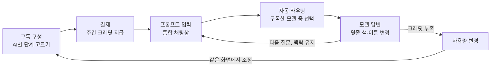

# Siempre PRD01 — AI 통합 구독 서비스 MVP

> 버전: PRD01 (첫 번째 PRD) · 작성일 2026-11-05

Nov 5, 2026 · @김형민

## 개요

Siempre(가칭, 서비스 이름 미정)는 프롬프트 하나로 Claude, ChatGPT, Gemini, ElevenLabs, 이미지 모델 중 알맞은 모델을 자동으로 골라 답하고, 쓰는 AI만 골라 장바구니식으로 구독하는 AI 통합 서비스다.

- 이 PRD는 레포의 네 자료만 근거로 한다: 11.05 회의녹음, 서비스 소개서(A4), 구독 선택 화면 시안, AI 서비스 손익추정 시트.
- 범위는 MVP: 구독 구성 → 결제 → 통합 채팅까지 한 사람이 끝까지 쓸 수 있는 최소 흐름.
- 자료끼리 맞지 않는 부분은 결정하지 않고 '열린 질문'에 남겼다.

## 문제와 타깃 사용자

여러 AI를 같이 쓰는 사람은 돈을 중복으로 내고, 맥락을 옮기느라 시간을 쓴다.

| 문제 | 근거 |
| --- | --- |
| AI 5개를 따로 구독하면 월 약 11만 원인데 각각 다 쓰지 못한다 | 서비스 소개서, 회의("주간 사용량 100% 쓴 적 없다") |
| 모델을 바꿀 때마다 내용을 복사해 다시 설명해야 한다 | 회의 |
| 어떤 작업에 어떤 모델이 나은지 직접 판단해야 한다 | 서비스 소개서, 회의(질문 분석 후 모델 추천 요청) |
| 여러 AI를 번갈아 쓰다 지금 어느 모델을 쓰는지 헷갈린다 | 회의("바꿨을 때 화면 윗줄 색이 변했으면") |

**초기 타깃**(서비스 소개서): 여러 AI를 동시에 쓰는 대학생, 1인 크리에이터, 마케터. 회의에서는 헤비 유저와 라이트 유저 중 어느 쪽을 주로 노릴지 결론이 나지 않았다.

## 목표와 성공 지표

1년 차 목표는 유료 가입자 1만 명, 연 매출 ₩36억이다(서비스 소개서). 수익 구조는 크레딧 사용률에 달려 있어, MVP는 이 값을 재는 것부터 해야 한다.

| 지표 | 목표(기본) | 범위 | 출처 |
| --- | --- | --- | --- |
| 유료 가입자(1년 차 말) | 10,000명 | 보수 3,000 · 낙관 30,000 | 소개서, 손익 시트 |
| 무료→유료 전환율 | 5% | — | 손익 시트 |
| 유료 가입자 1인 월 평균 결제액 | ₩30,000 | — | 손익 시트 |
| 크레딧 사용률 | 65% 이하 유지 | 100%에 가까우면 기본 시나리오도 적자 | 손익 시트 |
| 매출총이익률 | 27~35% | — | 소개서 |

MVP 자체의 판단 기준: 사용자가 구독 구성을 끝까지 마치는지, 그리고 한 대화 안에서 두 개 이상의 모델을 쓰는지.

## MVP 기능 요구사항

P0 다섯 기능이 되면 출시할 수 있고, P1 두 기능은 그다음이다.

| 기능 | 요구사항 | 우선순위 | 출처 |
| --- | --- | --- | --- |
| 장바구니식 구독 구성 | AI 5종(ChatGPT, Claude, Gemini, 음성, 이미지)마다 안 씀·라이트·스탠다드·헤비 중 하나를 고른다. 고를 때마다 월 결제액, 크레딧, 공식 구독 대비 절약액이 바로 바뀜다. | P0 | 구독 선택 시안 |
| 결제와 크레딧 지급 | 월 구독료만큼 크레딧을 매주 나눠 주고 이월하지 않는다. 남은 크레딧과 다음 지급일을 보여 준다. | P0 | 소개서, 손익 시트 |
| 통합 채팅 | 한 대화창에서 여러 모델을 쓰고, 모델을 바꿔도 앞의 맥락을 이어받는다. 글, 코드, 이미지, 음성 결과가 같은 대화에 나온다. | P0 | 소개서, 회의 |
| 자동 라우팅 | 요청을 분석해 구독 중인 모델 가운데 알맞은 것으로 보낸다. 사용자가 직접 모델을 고를 수도 있다. | P0 | 소개서, 회의 |
| 현재 모델 표시 | 답하는 모델이 바뀌면 화면 윗줄 색과 이름이 바뀌어 지금 어느 모델인지 한눈에 알 수 있다. | P0 | 회의 |
| 가벼운 대화 무제한 | 건당 원가 1~2원인 저가 모델은 공정 사용 한도 안에서 크레딧을 차감하지 않는다. | P1 | 소개서 |
| 무료 플랜 | 저가 모델 위주로 쓸 수 있고 유료 전환을 유도한다(1인 원가 월 ₩100 가정). | P1 | 손익 시트 |

## 요금제와 크레딧 정책

요금은 AI별 단계를 더한 뒤, 3개 이상 묶으면 5%를 할인한다. 아래 가격은 구독 선택 시안의 값이다(월, 부가세 포함, 2026년 11월 기준).

| AI | 라이트 | 스탠다드 | 헤비 | 비교 공식 구독 |
| --- | --- | --- | --- | --- |
| ChatGPT | ₩8,900 · 대화 150회, 고난도 5회 | ₩17,900 · 300회, 10회 | ₩44,900 · 700회, 30회 | Plus ₩29,000 |
| Claude | ₩7,900 · 대화 150회, 고난도 5회 | ₩15,900 · 300회, 15회 | ₩38,900 · 700회, 40회 | Pro ₩32,600 |
| Gemini | ₩4,900 · 대화 200회, 고난도 5회 | ₩11,900 · 500회, 15회 | ₩27,900 · 1,200회, 40회 | Google AI Pro ₩29,000 |
| 음성(ElevenLabs) | ₩1,900 · 5,000자 | ₩4,900 · 15,000자 | ₩10,900 · 40,000자 | Starter ₩9,800 |
| 이미지 | ₩3,900 · 20장 | ₩10,900 · 60장 | ₩26,900 · 150장 | Midjourney Basic ₩16,300 |

- **예시**: Claude·Gemini·이미지 라이트 = ₩16,700 − 묶음 할인 ₩840 = 월 ₩15,860, 매달 1,586 크레딧.
- **크레딧**: 시안에서는 ₩10 = 1크레딧이고, 고른 AI 어디에나 나눠 쓸 수 있다.
- **지급**: 월 크레딧을 주 단위로 나눠 주고 다음 주로 이월하지 않는다. 사용량은 언제든 바꿀 수 있다.
- **원가**: 공급사에는 쓴 만큼의 API 토큰만 낸다. 크레딧을 다 썼을 때 원가는 1인 월 ₩20,000으로 가정한다(손익 시트).

## 사용자 흐름과 화면 목록

한 번 구성하고 결제하면 이후는 채팅 루프만 돈다. 크레딧이 부족하면 구독 구성 화면으로 돌아가 사용량만 바꾼다.

| 화면 | 핵심 요소 |
| --- | --- |
| 1단계 · 구독 구성 | AI 5종 카드(안 씀/라이트/스탠다드/헤비), 공식 구독 대비 절약 문구, 오른쪽 고정 요약(항목, 묶음 할인, 월 결제액, 크레딧, 절약액) |
| 2단계 · 결제 | 구성 확인, 주간 지급·이월 없음 안내, 결제 버튼 |
| 통합 채팅 | 모델별 색이 바뀌는 윗줄, 자동/수동 모델 선택, 답변마다 모델 표시, 이번 주 남은 크레딧 |

## 범위 밖, 리스크, 열린 질문

회의에서 장바구니식 구독으로 확정했고, 나머지 판매 방식은 MVP에서 뺀다.

**범위 밖**

- 한 질문에 여러 모델이 동시에 답하는 병렬 비교(벤치마킹한 경쟁 서비스의 기능)
- 사용자가 AI별 비율을 직접 나누는 패키징, 입문·표준·상위 3종 토큰제 요금(회의에서 나온 대안)
- 다른 서비스에 들어가는 플러그인 형태

**리스크**

- 크레딧 사용률이 100%에 가까워지면 기본 시나리오도 적자다. 헤비 유저를 노리면 사용률이 가정(65%)보다 높을 수 있다.
- 모델을 바꿀 때 전체 대화 기록을 새 모델에 다시 보내야 해서 토큰 비용이 늘어난다.
- 공급사 쪽에는 '남는 토큰'이 없다. 이익은 우리가 지급한 크레딧 중 안 쓴 부분에서만 나온다.
- 국내에는 여러 AI를 무료로 모은 뤤튼이 있다. 차별점은 자동 라우팅과 쓴 만큼 내는 상위 모델이다.

**열린 질문**

- [ ] 서비스 이름과 팀명은? (자료에는 [서비스 이름], 회의에서는 가명 '모델 믹스')
- [ ] 주 타깃은 헤비 유저인가, 라이트 유저인가?
- [ ] 크레딧 1개를 모델별 토큰으로 어떻게 환산하나? 입력·출력 토큰 단가 차이는 아직 반영하지 않았다.
- [ ] 매출총이익률 목표를 맞춘다: 손익 시트 기본값(₩30,000, 원가 ₩20,000, 사용률 65%, 수수료 3.5%)으로 계산하면 약 48%로, 소개서의 27~35%와 다르다.
- [ ] 자동 라우팅이 구독하지 않은 AI가 더 맞다고 판단하면 어떻게 하나? (추천만 보여 줄지, 구독 추가를 제안할지)
- [ ] 가벼운 대화 무제한의 '공정 사용 한도'는 몇 회인가?
